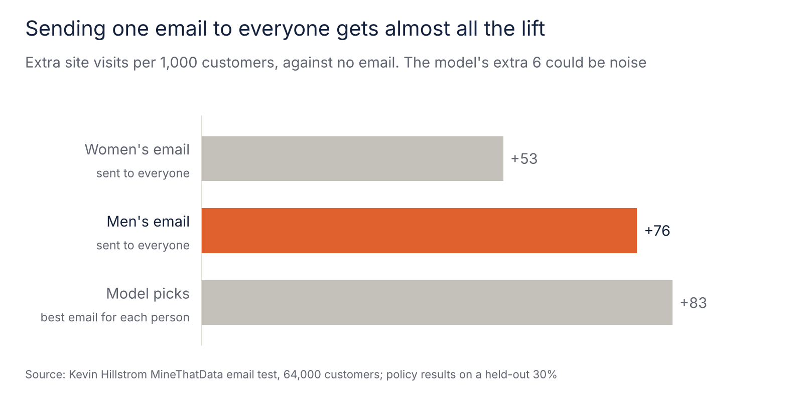
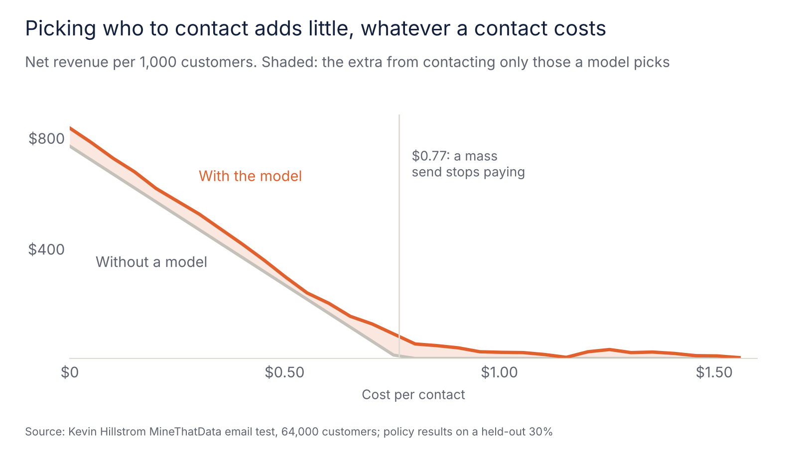

# Campaign Uplift Targeting: When Is Personalised Targeting Worth It?

**[Try the live app](https://ekene-uplift-targeting.streamlit.app/)**: set your cost per contact and see whether to contact everyone, target, or skip the campaign.

An analysis of a randomised email test with 64,000 customers. It measures what each email actually caused, tests whether a per-customer uplift model beats a simple rule, and works out how much a model adds at each cost per contact.

Built with **DuckDB SQL** and **Python (scikit-learn)**.

## The question

An online retailer split its customers at random into three groups: one received a men's merchandise email, one a women's merchandise email, and one received nothing. Visits, purchases and spend were tracked for two weeks.

Marketing teams are often told to personalise: build a model, send each customer the message they will respond to, and skip the people who will not. That takes a second creative, a model and ongoing upkeep. **Is it worth it here, and if not, when would it be?**

The key idea is **uplift**: the value of an email is the extra behaviour it causes compared with doing nothing, rather than how many recipients buy.

## The answer

**For email, no. Send one email, the men's, to everyone. A targeting model adds little at any contact cost; its one real use is finding a small group still worth contacting once a mass send stops paying.**

1. **One email does almost all the work.** Sending everyone the men's email produced 76 extra visits per 1,000 customers. Letting the model choose each customer's email added only 6 more, and the 95% interval (-1 to +13) includes zero. A second creative and a targeting model are not worth building for this channel
2. **The women's email is never the clear winner.** It ties the men's email for women-only buyers (+7.4 vs +7.1 points of visits) and barely moves men-only buyers (+1.1 points against +6.9), who are 45% of the file
3. **The model's edge is small at every contact cost.** Without a model, the best choice is to email everyone while a contact costs less than about **$0.77** (7.6% of what an extra visit is worth) and to skip the campaign above that. The model beats that choice by at most **$76 per 1,000 customers** at any cost, and part of that gain may be noise. Its one clear use is above $0.77, where a mass send no longer pays but a small group still does: at $0.90 per contact, the top 30% by predicted uplift earns $39 per 1,000 customers instead of nothing. That matters for direct mail, discounts or sales calls, not email
4. **Decide on visits, not spend.** The men's email beat the women's on visits by 3.1 points (95% interval 2.4 to 3.8). The spend gap ($0.35 per customer, interval -$0.04 to +$0.72) could be noise, because only about 1% of customers buy

**What would change the answer:** a test with more distinct creatives (where picking the right message matters more), real contact costs such as unsubscribes and fatigue, or valuing a visit by profit instead of revenue, which moves the break-even point lower (at a 40% margin, about $0.31 per contact).

## Charts





## Results

### What each email caused (all customers)

| Email | Visit rate | Extra visits vs no email | Conversion rate | Extra spend per customer (95% CI) |
|---|---|---|---|---|
| No email (control) | 10.6% |  | 0.57% |  |
| Men's email | 18.3% | +7.7 pts | 1.25% | +$0.77 ($0.49 to $1.05) |
| Women's email | 15.1% | +4.5 pts | 0.88% | +$0.42 ($0.18 to $0.69) |

Confidence intervals come from 2,000 bootstrap resamples. A balance check ([`results/balance_check.csv`](results/balance_check.csv)) confirms the three groups looked the same before the test (recency, past spend, share of new customers and product history all match to within 1%).

### Is the difference real?

| Comparison | Measure | Estimate | 95% interval | Clear difference? |
|---|---|---|---|---|
| Model picks the email vs men's email to everyone | Extra visits per 1,000 | +6.2 | -0.8 to +13.1 | No |
| Men's email vs women's email | Visit rate | +3.1 pts | +2.4 to +3.8 | Yes |
| Men's email vs women's email | Extra spend per customer | +$0.35 | -$0.04 to +$0.72 | No |

Source: [`results/is_the_difference_real.csv`](results/is_the_difference_real.csv)

### When targeting pays (held-out 30%, per 1,000 customers)

The rule contacts a customer only when their predicted uplift (extra visits per contact) is worth more than the contact costs. It uses the model's predictions alone; the results come from the held-out randomised test.

| Cost per contact (as share of an extra visit's value) | At $10 per visit | Share worth contacting | Net extra visits, targeted | Net extra visits, contact everyone |
|---|---|---|---|---|
| 6% | $0.60 | 77% | 19.8 | 16.2 |
| 7.5% | $0.75 | 51% | 8.8 | 1.2 |
| 9% | $0.90 | 29% | 3.8 | -13.8 |
| 12% | $1.20 | 9% | 2.4 | -43.8 |

Full curve: [`results/breakeven_curve.csv`](results/breakeven_curve.csv)

### Where each email works

| Customers who previously bought | Customers | Men's email: extra visits | Women's email: extra visits | Better email |
|---|---|---|---|---|
| Men's products only | 28,818 | +6.9 pts | +1.1 pts | Men's |
| Women's products only | 28,734 | +7.1 pts | +7.4 pts | Either (model decides) |
| Both | 6,448 | +13.4 pts | +7.1 pts | Men's |

Full segment results, including area, channel and new vs existing customers, are in [`results/segment_uplift.csv`](results/segment_uplift.csv).

### How targeting policies compare (held-out 30%, per 1,000 customers)

| Policy | Emails sent | Visits | Spend (95% CI) |
|---|---|---|---|
| Email nobody | 0 | 102 | $738 ($496 to $1,013) |
| Women's email to everyone | 1,000 | 155 | $1,199 ($836 to $1,646) |
| Men's email to everyone | 1,000 | 179 | $1,239 ($883 to $1,650) |
| **Model picks the email, everyone** | 1,000 | **185** | $1,369 ($987 to $1,786) |
| Model picks the email, top 50% only | 500 | 149 | $1,093 ($794 to $1,451) |

Visits are the reliable signal here. Spend is so sparse (about 1% of customers buy) that the spend intervals overlap heavily, so spend differences between policies are directional rather than proven.

## How it works

1. **Measure the test (SQL and bootstrap).** Results per group, a balance check, and uplift by segment as treated minus control within each segment ([`sql/`](sql))
2. **Model uplift (T-learner).** Three gradient-boosted models, one per group, each predicting a customer's chance of visiting from recency, past spend, product history, new-customer flag, area and channel. A customer's predicted uplift for an email = predicted visit chance with that email minus without it
3. **Recommend an email.** Each customer gets the email with the higher predicted uplift
4. **Evaluate honestly on held-out data.** The model trains on 70% of customers. On the other 30%, the random assignment is used to estimate what would have happened under each policy (inverse probability weighting: customers whose actual email matches the policy stand in for everyone, weighted by 3 because each group had a 1 in 3 chance)
5. **Test whether it is worth it.** A paired bootstrap compares the model against the simple rule on the same held-out customers, and a cost-per-contact sweep finds where targeting starts to beat contacting everyone

## Repository structure

```
app.py                        interactive explorer (Streamlit)
sql/
  01_experiment_results.sql   customer table, results per group, balance check
  02_segment_uplift.sql       uplift by purchase history, area, channel and tenure
scripts/
  run_all.py                  SQL, bootstrap confidence intervals, uplift model, policy evaluation
  make_charts.py              README charts
  brand_style.py              shared chart style
results/
  targeting_list.csv          every customer's recommended email and predicted uplift
  targeting_curve.csv         share of extra visits captured by targeting depth
  policy_comparison.csv       held-out results for each targeting policy
  is_the_difference_real.csv  bootstrap tests: model vs simple rule, men's vs women's email
  breakeven_curve.csv         net value of targeting vs contacting everyone, by cost per contact
  ...                         plus topline, segment and balance results
charts/                       README charts
```

## How to run it

1. Download the dataset (see *Data source* below) and save it as `data/raw/hillstrom.csv`
2. Run:

```bash
pip install duckdb pandas scikit-learn matplotlib
python scripts/run_all.py
python scripts/make_charts.py
```

## Limitations

- **Two-week window.** The test measured short-term response only. Effects on unsubscribes and longer-term spend are unknown
- **Spend is noisy.** With about 1% of customers buying, spend estimates have wide intervals; the model is trained on visits, a denser signal, and spend is used for evaluation only
- **One campaign.** The finding that the men's email wins may reflect this particular creative and season rather than a lasting rule. Re-test before treating it as policy
- **No contact costs in the data.** Email cost and fatigue are not measured. The break-even analysis shows how to decide once a cost per contact is known
- **Revenue, not profit.** The $10 per extra visit is revenue observed in the test; use profit per visit for a stricter break-even

## Data source

Kevin Hillstrom, "The MineThatData E-Mail Analytics And Data Mining Challenge" (2008), published on the MineThatData blog for public analysis. The raw file is not redistributed here. Code in this repository is MIT licensed.
