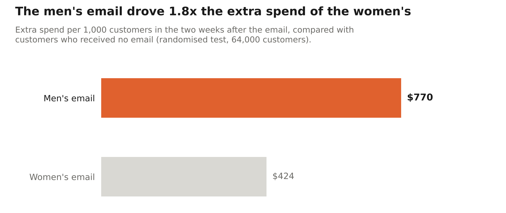
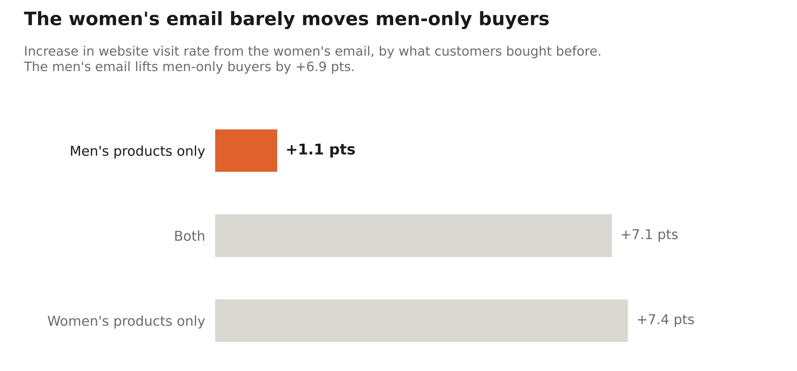

# Campaign Uplift Targeting: Who Should Get Which Email?

**[Try the live app](https://ekene-uplift-targeting.streamlit.app/)**: pick a customer segment and see which email works, and how many customers are worth emailing.

An analysis of a randomised email test with 64,000 customers. It measures what each email actually caused, finds which customers each email works for, and builds an uplift model that recommends the right email for every customer.

Built with **DuckDB SQL** and **Python (scikit-learn)**.

## The question

An online retailer split its customers at random into three groups: one received a men's merchandise email, one a women's merchandise email, and one received nothing. Visits, purchases and spend were tracked for two weeks.

**Which email should each customer get, and should some customers get no email at all?**

The key idea is **uplift**: the value of an email is the extra behaviour it causes compared with doing nothing, rather than how many recipients buy. Some customers would buy anyway; some will not respond to anything. Marketing spend should go to the customers whose behaviour actually changes.

## The recommendation

1. **Make the men's email the default.** It caused $770 in extra spend per 1,000 customers, 1.8x the women's email ($424), and it beats the women's email on visits in every area, channel and customer-tenure segment
2. **Never send the women's email to men-only buyers.** It lifts their visit rate by just 1.1 points, against 6.9 points for the men's email. That group is 45% of the file
3. **Let the model choose for women-only buyers.** The two emails perform the same for this group on average (+7.4 vs +7.1 points of visits). The model splits them roughly in half, sending each customer the email they are predicted to respond to more
4. **Keep the list broad.** Ranking customers by predicted uplift concentrates the effect only modestly: emailing the top half captures 57% of the extra visits. With email costing almost nothing, cutting the list would give up 43% of the gain to save half the sends. Use uplift ranking to trim the list when each contact has a real cost, such as a discount, direct mail or a strict frequency cap

On a held-out 30% of customers, letting the model choose the email for everyone produced 185 visits per 1,000 customers, against 179 for sending everyone the men's email and 102 for sending nothing.

## Try it yourself

**Live app: [ekene-uplift-targeting.streamlit.app](https://ekene-uplift-targeting.streamlit.app/)**

An interactive explorer ([`app.py`](app.py)) lets you pick any customer segment and see which email works better for it, then set a cost per email and a value per extra visit to see how many customers are worth emailing. It runs on the model outputs in `results/`, so it needs no raw data. To run it locally:

```bash
pip install -r requirements.txt
streamlit run app.py
```

## Charts





## Results

### What each email caused (all customers)

| Email | Visit rate | Extra visits vs no email | Conversion rate | Extra spend per customer (95% CI) |
|---|---|---|---|---|
| No email (control) | 10.6% |  | 0.57% |  |
| Men's email | 18.3% | +7.7 pts | 1.25% | +$0.77 ($0.49 to $1.05) |
| Women's email | 15.1% | +4.5 pts | 0.88% | +$0.42 ($0.18 to $0.69) |

Confidence intervals come from 2,000 bootstrap resamples. A balance check ([`results/balance_check.csv`](results/balance_check.csv)) confirms the three groups looked the same before the test (recency, past spend, share of new customers and product history all match to within 1%).

### Where each email works

| Customers who previously bought | Customers | Men's email: extra visits | Women's email: extra visits | Better email |
|---|---|---|---|---|
| Men's products only | 28,818 | +6.9 pts | +1.1 pts | Men's |
| Women's products only | 28,734 | +7.1 pts | +7.4 pts | Either (model decides) |
| Both | 6,448 | +13.4 pts | +7.1 pts | Men's |

Full segment results, including area, channel and new vs existing customers, are in [`results/segment_uplift.csv`](results/segment_uplift.csv).

### How targeting policies compare (held-out 30%, per 1,000 customers)

| Policy | Emails sent | Visits | Spend (95% CI) |
|---|---|---|---|
| Email nobody | 0 | 102 | $738 ($496 to $1,013) |
| Women's email to everyone | 1,000 | 155 | $1,199 ($836 to $1,646) |
| Men's email to everyone | 1,000 | 179 | $1,239 ($883 to $1,650) |
| **Model picks the email, everyone** | 1,000 | **185** | $1,369 ($987 to $1,786) |
| Model picks the email, top 50% only | 500 | 149 | $1,093 ($794 to $1,451) |

Visits are the reliable signal here. Spend is so sparse (about 1% of customers buy) that the spend intervals overlap heavily, so spend differences between the email policies are directional rather than proven.

## How it works

1. **Measure the test (SQL and bootstrap).** Results per group, a balance check, and uplift by segment as treated minus control within each segment ([`sql/`](sql))
2. **Model uplift (T-learner).** Three gradient-boosted models, one per group, each predicting a customer's chance of visiting from recency, past spend, product history, new-customer flag, area and channel. A customer's predicted uplift for an email = predicted visit chance with that email minus without it
3. **Recommend an email.** Each customer gets the email with the higher predicted uplift
4. **Evaluate honestly on held-out data.** The model trains on 70% of customers. On the other 30%, the random assignment is used to estimate what would have happened under each policy (inverse probability weighting: customers whose actual email matches the policy stand in for everyone, weighted by 3 because each group had a 1 in 3 chance)

## Repository structure

```
app.py                        interactive explorer (Streamlit)
sql/
  01_experiment_results.sql   customer table, results per group, balance check
  02_segment_uplift.sql       uplift by purchase history, area, channel and tenure
scripts/
  run_all.py                  SQL, bootstrap confidence intervals, uplift model, policy evaluation
  make_charts.py              README charts
results/
  targeting_list.csv          every customer's recommended email and predicted uplift
  targeting_curve.csv         share of extra visits captured by targeting depth
  policy_comparison.csv       held-out results for each targeting policy
  ...                         plus topline, segment and balance results
charts/                       README charts
```

## How to run it

1. Download the dataset (see *Data source* below) and save it as `data/raw/hillstrom.csv`
2. Run:

```bash
pip install duckdb pandas scikit-learn matplotlib
python scripts/run_all.py
python scripts/make_charts.py
```

## Limitations

- **Two-week window.** The test measured short-term response only. Effects on unsubscribes and longer-term spend are unknown
- **Spend is noisy.** With about 1% of customers buying, spend estimates have wide intervals; the model is trained on visits, a denser signal, and spend is used for evaluation only
- **One campaign.** The finding that the men's email wins may reflect this particular creative and season rather than a lasting rule. Re-test before treating it as policy
- **No contact costs.** Email cost and fatigue are not in the data. The targeting curve shows how to decide once a cost per contact is known

## Data source

Kevin Hillstrom, "The MineThatData E-Mail Analytics And Data Mining Challenge" (2008), published on the MineThatData blog for public analysis. The raw file is not redistributed here. Code in this repository is MIT licensed.
